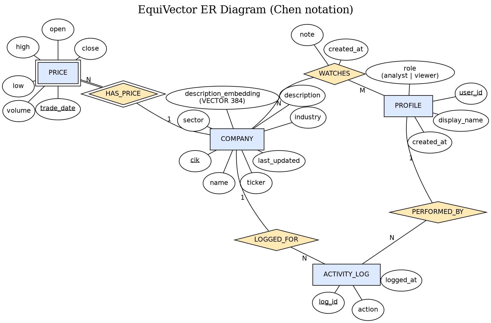

# EquiVector — Architecture & Design Spec

## 1. Project Title
**EquiVector: A Hybrid SQL–Vector Platform for Stock Market Analytics and Semantic Company Discovery**

## 2. One-Line Pitch
A static-data (batch-seeded) equity dashboard where structured price/fundamental data lives in Postgres, and company descriptions are embedded into pgvector so users can semantically search for "companies like this one" — beyond keyword matching.

## 3. Core Design Decisions (locked)

| Decision | Choice | Why |
|---|---|---|
| SQL DB | PostgreSQL via Supabase | Managed, free tier, GUI table editor |
| Vector DB | pgvector (extension inside same Postgres) | Satisfies "SQL + Vector" requirement without running a second DB server |
| Auth | Supabase built-in Auth (login/session) | Handles login/session with near-zero custom code |
| Roles | `profiles.role` column (`analyst` / `viewer`), CHECK-constrained | Role validation lives in the database (rubric: DB-level validation), and watchlists/logs can FK to it |
| Frontend/Backend | Next.js (single app, API routes as backend layer) | One framework, satisfies "DB behind API layer" requirement |
| Language | TypeScript | Safer generated code, standard for this stack |
| DB access | Raw SQL via the `pg` driver + `DATABASE_URL` env var (no ORM, no supabase-js for data) | supabase-js cannot run raw SQL or multi-statement transactions; `pg` gives real `BEGIN/COMMIT/ROLLBACK` on one pooled client. Supabase is only the Postgres host + Auth |
| UI | shadcn/ui components | Prebuilt, no custom design work needed |
| Deployment | Local only, run for demo day | Zero deploy overhead |
| Embeddings | sentence-transformers (local, free, one-time script) | No API cost, run once during seeding |
| Primary data source | yfinance (Python) | One library gives both price history AND `longBusinessSummary` (company description) per ticker |
| Company identity | CIK (SEC Central Index Key) as primary key, ticker as separate column | CIK is permanent; ticker/name can change — correct modeling choice |
| "Live" simulation | Two-batch seeding (real historical dates as "week 1" / "week 2") | Demonstrates INSERT/UPDATE/trigger behavior without needing a live feed |
| ER diagram | **Chen notation** (instructor requirement), written as Graphviz DOT | Code-generated, renders in any online Graphviz tool; see Appendix A |
| Table count | 5 tables (rubric minimum), no extras unless needed | `profiles` is the only table added to the original 4 |

## 4. Data Sources

- **Prices + descriptions:** `yfinance` Python library — pulled once, saved to CSV, never called live from the app.
  - Price history → `prices` table.
  - `.info["longBusinessSummary"]` → `description` column, later embedded.
  - `.info["sector"]` / `.info["industry"]` → plain text columns on `companies`.
- **Company identity (CIK):** SEC's public `company_tickers.json` (free, no key) — maps ticker → CIK → name.
- **Fallback for missing descriptions:** Alpha Vantage `OVERVIEW` endpoint (free tier) — only used to patch gaps, not primary source.

## 5. Database Schema (SQL side) — 5 tables

> **The authoritative DDL is [`db/schema.sql`](db/schema.sql).** The sketch below shows the shape only. The real file adds named CHECK constraints (CIK/ticker format, positive prices, high/low consistency, no weekend bars, role and action whitelists, note length), `NOT NULL` on OHLCV, `ON DELETE CASCADE` on prices/watchlists, `NUMERIC(12,4)` prices and `TIMESTAMPTZ` timestamps.

```sql
-- 1. Companies (structured + description text that gets embedded)
CREATE TABLE companies (
    cik            VARCHAR(10) PRIMARY KEY,      -- SEC Central Index Key
    ticker         VARCHAR(10) UNIQUE NOT NULL,
    name           TEXT NOT NULL,
    sector         TEXT,
    industry       TEXT,
    description    TEXT,                          -- raw text, source for embedding
    description_embedding VECTOR(384),            -- pgvector column (all-MiniLM-L6-v2 dim)
    last_updated   TIMESTAMP DEFAULT now()
);

-- 2. Prices (time series, batch-seeded). Weak entity of companies:
--    identified by (cik, trade_date), so no surrogate id.
CREATE TABLE prices (
    cik         VARCHAR(10) NOT NULL REFERENCES companies(cik),
    trade_date  DATE NOT NULL,
    open        NUMERIC(10,2),
    close       NUMERIC(10,2),
    high        NUMERIC(10,2),
    low         NUMERIC(10,2),
    volume      BIGINT,
    PRIMARY KEY (cik, trade_date)
);

-- 3. Profiles (app-level user record; role lives here, not in auth metadata)
CREATE TABLE profiles (
    user_id      UUID PRIMARY KEY REFERENCES auth.users(id),
    display_name TEXT,
    role         TEXT NOT NULL DEFAULT 'viewer' CHECK (role IN ('analyst', 'viewer')),
    created_at   TIMESTAMP DEFAULT now()
);

-- 4. Watchlists (M:N between profiles and companies; note + created_at are
--    attributes of the WATCHES relationship). Composite PK also blocks duplicates.
CREATE TABLE watchlists (
    user_id     UUID NOT NULL REFERENCES profiles(user_id),
    cik         VARCHAR(10) NOT NULL REFERENCES companies(cik),
    note        TEXT,
    created_at  TIMESTAMP DEFAULT now(),
    PRIMARY KEY (user_id, cik)
);

-- 5. Activity log (written by the prices trigger and by the watchlist transaction)
CREATE TABLE activity_log (
    log_id      SERIAL PRIMARY KEY,
    action      TEXT,
    cik         VARCHAR(10) REFERENCES companies(cik) ON DELETE SET NULL,
    user_id     UUID REFERENCES profiles(user_id) ON DELETE SET NULL,  -- NULL for trigger/seed rows
    logged_at   TIMESTAMP DEFAULT now()
);
```

### Relationships (Chen view)
- `COMPANY` 1 — N `PRICE` via **HAS_PRICE** (identifying relationship; PRICE is a weak entity, total participation).
- `PROFILE` M — N `COMPANY` via **WATCHES** (attributes: `note`, `created_at`) → becomes the `watchlists` table.
- `ACTIVITY_LOG` N — 1 `COMPANY` via **LOGGED_FOR** (optional).
- `ACTIVITY_LOG` N — 1 `PROFILE` via **PERFORMED_BY** (optional).

## 6. Advanced Database Features (rubric: 4 SQL + 1 Vector/NoSQL)

**SQL (4):**
1. **View** — `top_movers`: joins `companies` + latest two `prices` rows per company, computes % change, sorted descending.
2. **Index** — `CREATE INDEX idx_prices_trade_date ON prices(trade_date);` — supports the cross-company "latest dates" scan behind `top_movers`. (The `(cik, trade_date)` lookup is already covered by the primary key, so a separate index on it would be a duplicate — do not create one.)
3. **Trigger** — `AFTER INSERT ON prices` → auto-updates `companies.last_updated`, and inserts a row into `activity_log`.
4. **Transaction** — adding a watchlist entry + writing its `activity_log` row (with `user_id`) in a single transaction. *Required, not optional: without it the project has only 3 SQL features.*

**Vector (1):**
5. **Vector similarity search** — `ORDER BY description_embedding <=> query_embedding LIMIT 5` (cosine distance), backed by an HNSW index using the matching opclass: `CREATE INDEX idx_companies_embedding ON companies USING hnsw (description_embedding vector_cosine_ops);` — powers the "similar companies" search. Full design in §6a.

## 6a. Vector Component (pgvector), documented per the rubric

| Rubric question | Answer |
|---|---|
| **What is embedded** | `companies.description`: the company's business summary (yfinance `longBusinessSummary`), one vector per company. Prices and fundamentals are *not* embedded. |
| **Model / approach** | `sentence-transformers/all-MiniLM-L6-v2`, run locally and once in `seed/embed_descriptions.py`. Output is 384-dim and **L2-normalised** (`normalize_embeddings=True`). Free, no API key, fast on a laptop CPU. |
| **Storage / data model** | `companies.description_embedding VECTOR(384)`: a column on the same row as the structured company data, so one `cik` key joins text, vector and prices. No separate collection or ID mapping to keep in sync. |
| **Metadata** | The rest of the `companies` row (`ticker`, `name`, `sector`, `industry`) acts as the vector's metadata and can be filtered in the same SQL statement (e.g. `WHERE sector = 'Technology'`). |
| **Similarity metric** | **Cosine distance**, pgvector operator `<=>` (0 = identical direction, 2 = opposite). Cosine compares meaning independent of text length. Because vectors are normalised, cosine order equals L2 and inner-product order, but `<=>` states the intent directly. Similarity = `1 - distance`. |
| **Index** | `CREATE INDEX idx_companies_embedding ON companies USING hnsw (description_embedding vector_cosine_ops);`. HNSW is an approximate nearest-neighbour graph, and the opclass **must** match the operator (`vector_cosine_ops` ↔ `<=>`) or the index is not used. With ~100 rows a sequential scan is also fast. The index is there to show how retrieval scales. |
| **Retrieval strategy** | Top-k nearest neighbours of an existing company: `SELECT ... FROM companies WHERE cik <> $1 ORDER BY description_embedding <=> (SELECT description_embedding FROM companies WHERE cik = $1) LIMIT k;` (k = 5). Free-text queries can be embedded the same way and compared with the same operator. |

### Why each kind of data lives where it does
- **Structured, exact, relational data goes in SQL tables**: prices (OHLCV by date), company identity (CIK, ticker), sector/industry labels, users, roles, watchlists, audit log. We need exact lookups, range scans over dates, aggregates (`AVG`, `corr()`), window functions (`LAG` for daily returns), joins, constraints (CHECK/FK/UNIQUE) and ACID transactions. A vector store offers none of these.
- **Free-text descriptions go in pgvector as embeddings.** "Which companies do similar things?" has no exact answer. Keyword or `LIKE` matching misses synonyms ("chips" vs "semiconductors"), and `sector` is too coarse (Tesla and Ford are both "Consumer Cyclical", so are Nike and McDonald's). Embeddings let us rank companies by meaning with nearest-neighbour search.
- **Why pgvector instead of a separate vector DB:** the vectors belong to the same entity as the SQL row. Keeping them in one Postgres means a single `JOIN`/`WHERE` can combine semantic distance with sector filters and price statistics. The novelty feature (§6b) depends on this, and there is no cross-database sync problem.

## 6b. Novelty: Semantic vs Statistical Similarity
For a chosen company, show its top-5 neighbours by **description embedding** (pgvector, cosine) next to its top-5 by **1-year daily-return Pearson correlation**. The correlation is computed in SQL: daily returns via `LAG(close) OVER (PARTITION BY cik ORDER BY trade_date)`, aligned on `trade_date`, then `corr()`. Display the overlap and the Jaccard score `|A ∩ B| / |A ∪ B|`. A report then asks: *does semantic similarity predict return correlation?* It compares the average return correlation of (a) semantic-neighbour pairs, (b) same-sector pairs and (c) random pairs, and reports whatever the data shows, including a negative result.

## 7. Application Architecture

```
Browser (Next.js pages, shadcn/ui components)
        │
        ▼
Next.js API Routes  (/app/api/*)      ← backend/API layer, env vars for DB creds
        │
        ▼
lib/db.ts: `pg` Pool (raw parameterised SQL, DATABASE_URL)
        │
        ▼
Postgres + pgvector (Supabase-hosted)
```

- **Auth flow:** Supabase Auth handles signup/login → a `profiles` row is created for the user with `role` (`analyst` / `viewer`, default `viewer`) → API routes read `profiles.role` before allowing writes (analyst can add watchlist notes / trigger re-seed; viewer is read-only).
- **No live external calls at runtime** — all market data is pre-seeded; the app only ever talks to Supabase.
- **Role enforcement is double:** API routes check `profiles.role` before writes, and the database rejects invalid roles via CHECK (Phase 4 adds DB-side enforcement for viewer writes).

## 8. Repo Structure

```
equivector/
├── README.md
├── .env.local.example
├── seed/
│   ├── tickers.txt            # the ~90-ticker universe
│   ├── fetch_data.py          # SEC CIKs + yfinance info/prices → data/raw/ (git-ignored)
│   ├── clean_data.py          # validate/drop bad rows → data/clean/ (committed; offline fallback)
│   ├── load_data.py           # --batch 1: companies + "week 1" prices; --batch 2: "week 2" → trigger fires
│   ├── embed_descriptions.py  # sentence-transformers → writes vectors into companies table
│   └── data/                  # raw/ + clean/ CSVs
├── db/
│   ├── schema.sql              # CREATE TABLE statements (5 tables)
│   ├── views.sql
│   ├── triggers.sql
│   ├── indexes.sql
│   ├── security.sql            # RLS lockdown vs Supabase REST API
│   ├── migrations/             # 001 ALTER, 002 DROP
│   ├── queries/                # documented standalone queries (similar_companies.sql)
│   ├── tests/                  # constraint tests, trigger snapshot
│   └── local/                  # auth_stub.sql for non-Supabase Postgres
├── app/
│   ├── api/
│   │   ├── companies/route.ts
│   │   ├── prices/route.ts
│   │   ├── top-movers/route.ts
│   │   ├── similar/route.ts     # vector similarity endpoint
│   │   └── watchlist/route.ts   # add = transaction (watchlist row + activity_log row)
│   ├── dashboard/page.tsx
│   ├── search/page.tsx
│   └── layout.tsx
├── components/                 # shadcn/ui-based components
├── lib/
│   └── db.ts                  # pg Pool + query helper (Supabase-js used only for Auth)
└── docs/
    ├── er-diagram.dot          # Chen-notation source (Appendix A)
    ├── ER-diagram.png          # rendered from the .dot
    ├── problem-statement.md
    └── testing-results.md
```

## 9. Build Order (the actual sequence to follow)

1. Set up Supabase project, enable `pgvector` extension.
2. Run `db/schema.sql` to create the 5 tables. Render `docs/er-diagram.dot` (Graphviz) for the Chen ER diagram.
3. `seed/fetch_data.py` — pull tickers/CIKs (SEC) + prices + descriptions + sector/industry (yfinance) → CSV.
4. Clean CSV, confirm ~50–100 companies have usable descriptions.
5. `seed/embed_descriptions.py` — generate embeddings, write into `companies.description_embedding`.
6. `seed/clean_data.py` then `seed/load_data.py --batch 1` — insert companies + first price batch.
7. Write `db/views.sql`, `db/triggers.sql`, `db/indexes.sql` (including the HNSW index) — apply via Supabase SQL editor.
8. `seed/load_data.py --batch 2` — insert second price batch (last 5 trading days) → confirm trigger fires, view reflects new top movers.
9. Scaffold Next.js app, wire the `pg` pool (lib/db.ts), build API routes (watchlist add as a transaction).
10. Build dashboard (top movers table, sector view) + search page (vector similarity).
11. Add Supabase Auth + `profiles` row on signup + role check on write routes.
12. Screenshot everything, write up docs, test each requirement against the brief checklist.

## 10. Open Items Still To Confirm
- Exact ~50–100 ticker list (pending your Kaggle/SEC pull).
- Embedding model assumed to be `all-MiniLM-L6-v2` (384-dim); `VECTOR(384)` and the HNSW index depend on it — confirm before writing `embed_descriptions.py`.

## Revision notes (vs. first draft)
- 4 → 5 tables: added `profiles`; `watchlists` now keyed by `(user_id, cik)` and pointing at `profiles`.
- `prices`: surrogate `id` dropped, composite PK `(cik, trade_date)` (weak entity); the old `idx_prices_cik_date` removed as redundant.
- `activity_log`: gained nullable `user_id`, FKs added with `ON DELETE SET NULL`, key renamed `log_id`.
- Roles moved from auth metadata to `profiles.role` with a CHECK constraint.
- Transaction promoted from "optional" to required (rubric needs 4 SQL features + 1 vector).
- ER diagram is Chen notation via Graphviz DOT.

## Revision notes (Phase 0 build)
- Vector metric changed from L2 (`<->`, `vector_l2_ops`) to **cosine** (`<=>`, `vector_cosine_ops`); embeddings are normalised.
- DB access switched from supabase-js to the `pg` driver (`DATABASE_URL`) so raw SQL and real transactions work. Supabase = Postgres host + Auth only.
- Schema hardened (see §5 note); `TIMESTAMP` → `TIMESTAMPTZ`; `activity_log.action` is NOT NULL with a whitelist.
- Added §6a (vector documentation + data-placement justification) and §6b (novelty feature).
- Seed scripts: `seed_batch1.py`/`seed_batch2.py` became `clean_data.py` + `load_data.py --batch 1|2`. Prices are split/dividend-adjusted (`auto_adjust=True`) so daily returns are not distorted by splits. Clean CSVs (real data, fetched 2026-10-25) are committed as the offline fallback.
- `db/security.sql`: RLS enabled (no policies) on all tables, so Supabase's public REST API cannot read or write them; the app connects as the owner via `pg`.
- Phase 2: `top_movers` finds the latest two trading dates via `idx_prices_trade_date` (Index Only Scan Backward), then joins prices by PK. Similarity queries pass the query vector as a scalar subquery (InitPlan), because a JOIN-supplied vector prevents the HNSW index from being used (verified with EXPLAIN). Added `db/migrations/` (001 ALTER, 002 DROP), `db/queries/`, `docs/evidence/`.
- Embedding model confirmed: all-MiniLM-L6-v2, 384-dim (closes Open Item 2).

## Appendix A — Chen ER diagram (Graphviz DOT)
Save as `docs/er-diagram.dot`; render with any Graphviz tool (neato engine). Double border = weak entity / identifying relationship; double line = total participation; underline = key / partial key.


