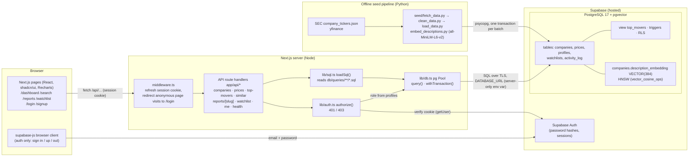
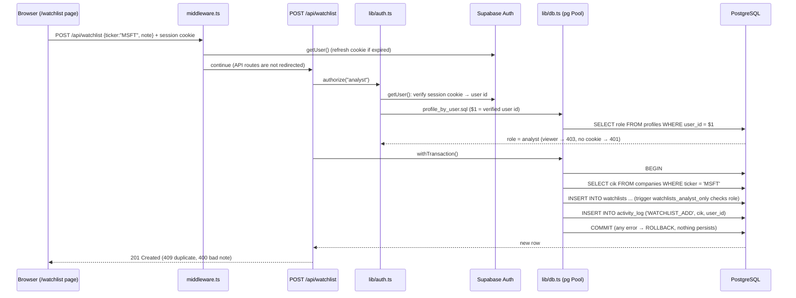

# System Architecture

## Components

## Request flow: page → API route → pg → Postgres
Example: an **analyst adds MSFT to their watchlist** (the full write path).

A **read** (e.g. `/reports`) follows the same path without the transaction: `authorize()` (any logged-in role) → `loadSql("reports/<file>.sql")` → `pool.query(text, params)` → JSON → the page renders a table and a Recharts chart.

## Layers and responsibilities
| Layer | Code | Responsibility |
|---|---|---|
| Presentation | `app/*/page.tsx`, `components/` | Client components; fetch JSON from the API; charts; hide write controls for viewers (cosmetic only) |
| Session | `middleware.ts`, `lib/supabase/` | Cookie sessions via `@supabase/ssr`; Supabase clients are used **only for auth** |
| API / backend | `app/api/**/route.ts`, `lib/api.ts` | Input checks, `authorize()`, mapping DB errors to HTTP (23505→409, 23514/23502/23503/22P02→400, 42501→403) |
| Data access | `lib/db.ts`, `lib/sql.ts`, `lib/watchlist.ts` | One `pg` Pool; parameterised SQL loaded from `db/queries`; `withTransaction()` |
| Database | `db/*.sql` | Schema, constraints, view, indexes, triggers, RLS, migrations |
| Data pipeline | `seed/*.py` | Offline fetch → clean → load → embed |

## Key design decisions
- **One database, two paradigms:** relational tables and pgvector embeddings live in the same Postgres, so vector distance and price statistics can be joined in one query ([database-choice-and-justification.md](database-choice-and-justification.md)).
- **`pg` driver, not supabase-js, for data:** raw SQL and real `BEGIN/COMMIT` on one pooled connection. `DATABASE_URL` is a session-mode connection string (transaction-mode pooling would break transactions) and is never prefixed `NEXT_PUBLIC_`, so it never reaches the browser. In Phase 4 the built browser bundle was checked: 0 files contain it.
- **All SQL in files:** `db/queries/**/*.sql`, one statement each, so what is shown in the viva is exactly what runs.
- **Defence in depth for roles:** API `authorize()` → 401/403, plus DB trigger `watchlists_analyst_only`, plus CHECK on `profiles.role`, plus RLS blocking the Supabase REST API.
- **No runtime calls to market APIs:** data is pre-seeded; the app only talks to Supabase.

## Deployment
Local for the demo: `npm run build && npm start` on http://localhost:3000, against the Supabase-hosted database (region and project in `.env.local`). The Python pipeline runs once from `seed/.venv`.
